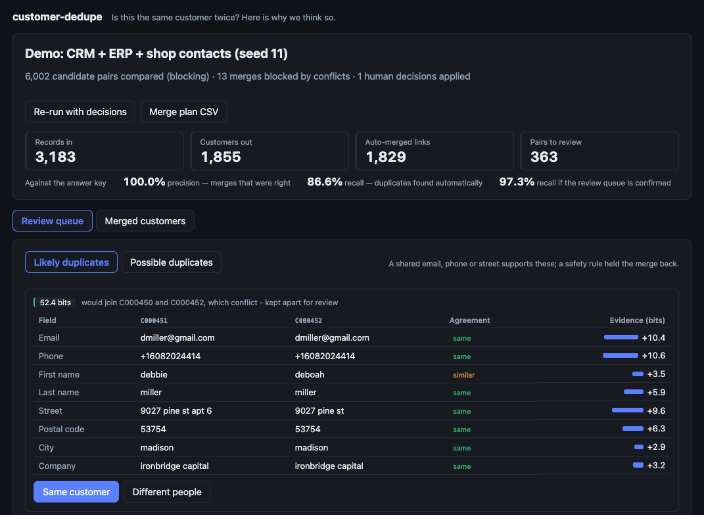
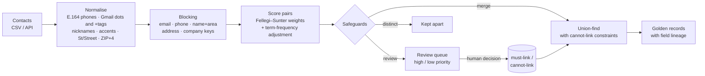
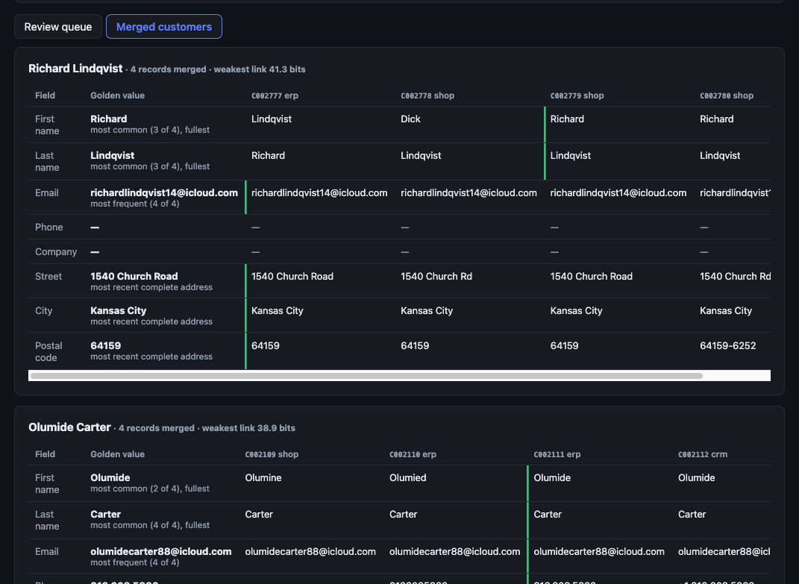

# customer-dedupe

**Is this the same customer twice? Here is exactly why we think so.**

Every company that has a CRM, an ERP and a web shop has the same person three times:
`Robert Smith, (816) 517-2606` in one system, `BOB SMITH, 8165172606, bobsmith+orders@gmail.com`
in another. Duplicates inflate customer counts, split order history and send three catalogues to
one house. The usual fixes are either a spreadsheet afternoon or a vendor black box that merges
things nobody can explain.

`customer-dedupe` finds duplicates, **explains every decision field by field**, refuses to merge
when it is not sure, and produces a golden record that says where each value came from.



## How it decides



**1. Normalise before comparing.** `(816) 517-2606`, `816.517.2606` and `+1 816 517 2606` are one
number. `Bob`, `Bobby` and `Robert` are one name. `John.Smith+shop@googlemail.com` is
`johnsmith@gmail.com`. Comparing raw strings is how most "these don't match" findings happen.

**2. Blocking instead of comparing everything.** 52,343 records would be 1.37 billion pairs; the
blocking keys reduce that to 781,352 candidates while still catching first/last name swaps and
people who moved (through their email or phone).

**3. Probabilistic scoring that explains itself.** For each field, `m` = P(agree | same person)
and `u` = P(agree | different people). Agreement adds log₂(m/u) bits of evidence, disagreement
subtracts, **missing data adds nothing** — an empty phone is not a different phone. Common values
are worth less: two `Smith`s agreeing proves less than two `Okonkwo`s. The score is the sum of the
evidence, and the UI shows every term.

**4. Safeguards where the maths is not enough.** Probabilities assume fields are independent;
real data is not:

| Situation | Why naive matching fails | Rule |
|---|---|---|
| Household: Robert and Chloe Smith share address and landline | Strong agreement on 4 fields | Clearly different first names → distinct |
| Two `Steven Garcia`s in the same ZIP | Name + place score high | Auto-merge needs a shared email, phone or street |
| `Mark` vs `Mary` at one address | One keystroke apart | Typo-level names only auto-merge when the email agrees |
| `Nicky` (Nicholas) vs `Vicky` (Victoria) | One keystroke apart | Typos are checked on what was written, not between nicknames |
| A → B → C chaining through a shared phone | Union-find is transitive | A union is refused if *any* record on one side conflicts with *any* on the other |

**5. Humans close the loop.** Pairs the model will not merge go to a review queue split into
*likely* (identity corroborated, a safeguard held it back) and *possible* (only name and place
agree). Decisions are stored as must-link / cannot-link constraints on the dataset and applied to
every later run.

**6. Golden record with lineage.** Each field records the source record and the rule that chose
it (most frequent, most recent, fullest name). Address fields always come from one record —
never a street from one system and a ZIP from another.



## How well it works

Measured on synthetic CRM / ERP / web-shop data with a known answer key (`dedupe benchmark`).
The generator plants typos, nicknames, swapped names, phone and email formats, missing fields,
households, colleagues and namesakes. Five datasets of 3,138–3,240 records:

| | Precision | Recall (automatic) | Recall if the review queue is confirmed |
|---|---|---|---|
| With safeguards | **1.000** on all 5 | 0.866 – 0.906 | 0.973 – 0.980 |
| Probabilistic score only (`--bare`) | 0.934 – 0.981 | 0.935 – 0.957 | 0.979 – 0.986 |

- The safeguards trade some automatic recall for precision: a wrong merge corrupts two customers'
  history and is expensive to undo; a missed one waits in the review queue.
- **Review queue quality:** across the 5 datasets, 763 of 793 *likely* items (96.2%) are real
  duplicates; 201 of 823 *possible* items (24.4%) are.
- **Scale (Apple M1, single process):** 10,521 records in 2.2 s; 52,343 records in 41.3 s
  (precision 0.9991, recall 0.900).

Honest caveats: the rules were developed against seeds 11–13 and checked on 14–15, but the data
comes from a generator written alongside the matcher, so treat these as regression gates, not a
promise about your CRM. Real data will need its own sample labelled.

The test suite enforces these numbers (precision ≥ 0.995, recall ≥ 0.84) and includes a
**positive control**: the bare model must fail the precision gate, so the gate is known to be
able to fail. Property-based tests check that every record lands in exactly one customer and that
no human "different" decision is ever overridden, and a regression test checks that results do
not depend on input order.

## Quick start

```bash
docker compose up --build      # http://localhost:8080 → "Run the demo"
```

Dev mode (source mounted, API auto-reload, Vite hot reload, Postgres on `localhost:5435`):

```bash
docker compose -f docker-compose.yml -f docker-compose.dev.yml up --build
# API http://localhost:8010/docs · dashboard http://localhost:5174
```

Locally:

```bash
cd backend && uv sync && uv run uvicorn customer_dedupe.api:create_app --factory   # :8000
cd frontend && pnpm install && pnpm dev                                            # :5173
```

### CLI

```bash
uv run dedupe demo --out contacts.csv
uv run dedupe run contacts.csv --plan merge-plan.csv --review review.csv
uv run dedupe run export.csv --mapping '{"id": "ContactId", "email": "Email Address"}'
uv run dedupe benchmark            # precision / recall on 5 synthetic datasets
uv run dedupe benchmark --bare     # same, without the safeguards
```

The **merge plan** has one row per input record: its customer, whether it is the surviving
record (the one already holding most golden values), and the golden values to write. Nothing is
merged in your systems — the plan is for review and for whatever does the writes.

## API

| Method | Path | |
|---|---|---|
| `POST` | `/api/jobs` | Multipart CSV + JSON column mapping. Same file → same dataset, new job |
| `POST` | `/api/jobs/demo` | Synthetic dataset, scored against its answer key |
| `GET` | `/api/jobs/{id}/clusters` | Merged customers with golden record and members |
| `GET` | `/api/jobs/{id}/review?priority=high` | Review queue with field-level evidence |
| `POST` | `/api/jobs/{id}/decisions` | `{a, b, same}` — stored for the dataset |
| `POST` | `/api/jobs/{id}/rerun` | New job applying every decision so far |
| `GET` | `/api/jobs/{id}/merge-plan.csv` | Streaming merge plan (formula injection neutralised) |

Uploads are capped by size and record count; the API never reads paths from a request.

## Layout

```
backend/src/customer_dedupe/
  normalize.py     phones, emails, names, companies, streets, postcodes
  nicknames.py     conservative nickname groups
  blocking.py      candidate pair generation
  compare.py       comparators, Fellegi–Sunter weights, safeguards
  cluster.py       union-find with cannot-link constraints
  survivorship.py  golden record + lineage
  engine.py        the pipeline
  synth.py         labelled synthetic data
  evaluate.py      pairwise precision / recall
  storage.py api.py cli.py io.py
frontend/          React review queue and customer view
```

## Limits and next steps

- `m` / `u` are set by hand from domain knowledge. With a labelled sample they should be learned
  (EM, as in Splink); the evidence model already supports it.
- Pure Python: 52,343 records took 41.3 s for 781,352 candidate pairs end to end. Beyond a few
  hundred thousand records, move the comparison step to a vectorised engine (DuckDB / Polars) or
  run blocks in parallel.
- English-language nickname list and US-centric postcode handling.

## License

MIT
